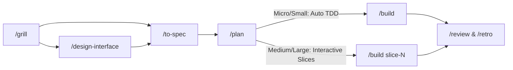

# Power Architect (`power-architect`)

A hybrid AI software architecture and TDD execution skill that combines **Matt Pocock's front-end domain shaping** ([`mattpocock/skills`](https://github.com/mattpocock/skills)) with **Jesse Vincent's autonomous TDD execution pipeline** ([`obra/superpowers`](https://github.com/obra/superpowers)).

## Workflow Pipeline



## Installation

### Via Skills CLI

```bash
npx skills add Hercules03/power-architect
```

### Manual Installation (Claude Code)

```bash
mkdir -p ~/.claude/skills/power-architect
cp skills/power-architect/SKILL.md ~/.claude/skills/power-architect/SKILL.md
```

### Starter Docs Templates

Copy the templates into your project to bootstrap the `docs/` convention:

```bash
cp -r templates/docs ./docs
```

## Commands

| Command | Phase | Description |
| --- | --- | --- |
| `/grill` | Alignment | Socratic decision-tree interrogation; updates `docs/CONTEXT.md` and `docs/adr/` |
| `/design-interface` | Architecture | "Design It Twice" interface comparison optimizing for deep modules |
| `/to-spec` | Specification | Synthesizes spec into `docs/specs/` and assigns Scope Tier (`Micro/Small` vs `Medium/Large`) |
| `/plan` | Planning | Generates autonomous micro-tasks (Small) or interactive vertical slices (Medium/Large) in `docs/plans/` |
| `/build` | Execution | Strict Red-Green-Refactor TDD with two-stage Spec + Quality self-review |
| `/debug` | Diagnostics | Scientific debugging: Reproduce -> Hypothesize -> Instrument -> Fix |
| `/review` | Verification | Two-pass audit (Pass 1: Spec Compliance, Pass 2: Code Quality) |
| `/retro` | Continuous Improvement | Writes session retrospective to `docs/retros/` and updates `docs/CONTEXT.md` |

## License

MIT
