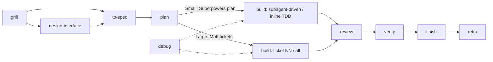

# Power Architect (`power-architect`)

One pipeline that runs two proven methodologies **as written**, each where it is strongest:

- **Matt Pocock's [`mattpocock/skills`](https://github.com/mattpocock/skills)** for alignment and design: grilling sessions, a shared domain glossary, deep-module interface design, specs, tracer-bullet tickets, two-axis code review, and environment retros.
- **Jesse Vincent's [`obra/superpowers`](https://github.com/obra/superpowers)** for disciplined execution: bite-sized implementation plans, subagent-driven TDD with fresh reviewers, systematic debugging, verification before completion, and branch finishing.

Power Architect adds only the glue: phase routing, a **Scope Tier** that picks which execution method applies, file conventions, and a next-step prompt. It is self-contained, so neither upstream pack needs to be installed. If one is installed, Power Architect uses the original skill for that phase.

## Workflow



## Installation

### Claude Code plugin (recommended)

Installs the skill **and** the `/power-architect:*` slash commands.

```text
/plugin marketplace add Hercules03/power-architect
/plugin install power-architect@power-architect
```

### Skill only (no slash commands)

Gives you `/power-architect` plus natural-language triggering (e.g. "grill me on the checkout feature"), but not the `/power-architect:*` commands.

```bash
npx skills add Hercules03/power-architect
```

### Starter templates (optional)

```bash
cp templates/GLOSSARY.md ./GLOSSARY.md
cp -r templates/docs ./docs
```

## Commands

| Command | Method | Output |
| --- | --- | --- |
| `/power-architect:grill` | Matt: `grilling` + `domain-modeling` | `GLOSSARY.md`, `docs/adr/` |
| `/power-architect:design-interface` | Matt: `codebase-design` (Design It Twice) | chosen interface (ADR if warranted) |
| `/power-architect:to-spec` | Matt: `to-spec` + Superpowers builder check | `docs/specs/`, confirmed test seams, Scope Tier |
| `/power-architect:plan` | Small: Superpowers `writing-plans` · Large: Matt `to-tickets` | `docs/plans/` |
| `/power-architect:build` | Small: Superpowers `subagent-driven-development` / `executing-plans` · Large: Matt `implement` / `implement-spec` | commits on a feature branch or worktree |
| `/power-architect:debug` | Matt `diagnosing-bugs` + Superpowers `systematic-debugging` | root-cause fix with regression test |
| `/power-architect:review` | Matt `code-review` + Superpowers `receiving-code-review` | Standards and Spec reports |
| `/power-architect:verify` | Superpowers `verification-before-completion` | evidence for every claim |
| `/power-architect:finish` | Superpowers `finishing-a-development-branch` | merge, PR, or keep |
| `/power-architect:retro` | Matt `retro` | environment improvements, most severe first |

## Where the two methods disagree

Each conflict is resolved by giving each method its own tier or phase, not by blending them:

| Topic | Superpowers | Matt Pocock | Power Architect |
| --- | --- | --- | --- |
| Refactoring | inside the TDD loop | in review, not in the loop | Small: in the loop · Large: in `/review` |
| File paths in written plans | required | banned in specs and tickets | Small-tier plans: yes · specs and Large-tier tickets: no |
| Asking the user | execution never stalls | confirm test seams first | seams confirmed in `/to-spec`, so `/build` runs without stopping |
| Domain language | — | `GLOSSARY.md`, no implementation details | `GLOSSARY.md` at the repo root |

## Credits & License

MIT. Adapted from `mattpocock/skills` (© Matt Pocock) and `obra/superpowers` (© Jesse Vincent), both MIT. See [THIRD_PARTY_NOTICES.md](THIRD_PARTY_NOTICES.md).
