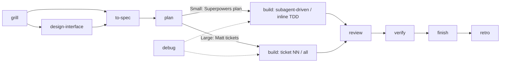

# Power Architect (`power-architect`)

One pipeline that runs two proven methodologies **as written**, each where it is strongest:

- **Matt Pocock's [`mattpocock/skills`](https://github.com/mattpocock/skills)** for alignment and design: grilling sessions, a shared domain glossary, deep-module interface design, specs, tracer-bullet tickets, two-axis code review, and environment retros.
- **Jesse Vincent's [`obra/superpowers`](https://github.com/obra/superpowers)** for disciplined execution: bite-sized implementation plans, subagent-driven TDD with fresh reviewers, systematic debugging, verification before completion, and branch finishing.

Power Architect adds only the glue: phase routing, a **Scope Tier** that picks which execution method applies, file conventions, and a next-step prompt. It is self-contained, so neither upstream pack needs to be installed. If one is installed, Power Architect uses the original skill for that phase.

## Workflow



## Installation

### Claude Code plugin (recommended)

Installs the skill **and** the `/power-architect:*` slash commands.

```text
/plugin marketplace add Hercules03/power-architect
/plugin install power-architect@power-architect
```

### Skill only (no slash commands)

Gives you `/power-architect` plus natural-language triggering (e.g. "grill me on the checkout feature"), but not the `/power-architect:*` commands.

```bash
npx skills add Hercules03/power-architect
```

### Starter templates (optional)

```bash
cp templates/GLOSSARY.md ./GLOSSARY.md
cp -r templates/docs ./docs
```

## Commands

| Command | Method | Output |
| --- | --- | --- |
| `/power-architect:grill` | Matt: `grilling` + `domain-modeling` | `GLOSSARY.md`, `docs/adr/` |
| `/power-architect:design-interface` | Matt: `codebase-design` (Design It Twice) | chosen interface (ADR if warranted) |
| `/power-architect:to-spec` | Matt: `to-spec` + Superpowers builder check | `docs/specs/`, confirmed test seams, Scope Tier |
| `/power-architect:plan` | Small: Superpowers `writing-plans` · Large: Matt `to-tickets` | `docs/plans/` |
| `/power-architect:build` | Small: Superpowers `subagent-driven-development` / `executing-plans` · Large: Matt `implement` / `implement-spec` | commits on a feature branch or worktree |
| `/power-architect:debug` | Matt `diagnosing-bugs` + Superpowers `systematic-debugging` | root-cause fix with regression test |
| `/power-architect:review` | Matt `code-review` + Superpowers `receiving-code-review` | Standards and Spec reports |
| `/power-architect:verify` | Superpowers `verification-before-completion` | evidence for every claim |
| `/power-architect:finish` | Superpowers `finishing-a-development-branch` | merge, PR, or keep |
| `/power-architect:retro` | Matt `retro` | environment improvements, most severe first |
| `/power-architect:setup-tracker` | Tracker Adapter Install | `## Tracker` section in AGENTS.md or CLAUDE.md |

## Tracker mode (Jira)

Opt-in. In Tracker mode Jira owns the work (specs, Epics, Stories, Sub-tasks, status) and the repo owns the Knowledge Docs (`GLOSSARY.md`, ADRs, DESIGN.md, AGENTS.md). Without a `## Tracker` section the pipeline runs in Local Files mode, exactly as above.

**Prerequisites:** the Atlassian Rovo MCP server connected and signed in; a Jira Cloud project with a Scrum board; a Confluence space for Spec Pages.

**Set up:** run `/power-architect:setup-tracker jira`. It picks the site, project, board and space, confirms the status mapping, and writes a `## Tracker` section into AGENTS.md or CLAUDE.md.

**Mapping:** a spec becomes a Spec Page; clusters of user stories become Epics; user stories become Stories with Acceptance Criteria; plan tasks (Small) or tickets (Large) become Sub-tasks. You create and fill Sprints; the agent never touches them.

| Command | Reads | Writes |
| --- | --- | --- |
| `to-spec` | the Spec Page, on a re-run | Spec Page, Epics, Stories |
| `plan` | the spec (Spec Page, Stories) | Sub-tasks, links, the Spec Page's Plan section |
| `build` | the active Sprint (or one Work Ref): Sub-tasks and Bugs | In Progress when work starts; Done with an evidence comment only after the review passes (the task review for S1 and L1, the spec's final review for S2 and L2, a Bug's own Bug review for Bugs) |
| `debug` | open Bugs | a comment on the item, or a Backlog Bug |
| `review` | the spec | comments on the current item |
| `verify` | the spec's Stories | Story to Done with a Verified comment |
| `finish` | none | the PR or merge link, as a comment on each delivered Story |

**Offline:** when Jira is unreachable, `record` queues the event in `.power-architect/<spec-slug>/progress.md` and the next `pull` replays it. `pull` and `publish` stop instead.

**Ledger root:** ledgers and queues live in the main checkout's `.power-architect/` (git-ignored), never in a linked worktree's.

**Local mode is unchanged.** Scenario tests for both modes are in [`tests/tracker/README.md`](tests/tracker/README.md).

## Where the two methods disagree

Each conflict is resolved by giving each method its own tier or phase, not by blending them:

| Topic | Superpowers | Matt Pocock | Power Architect |
| --- | --- | --- | --- |
| Refactoring | inside the TDD loop | in review, not in the loop | Small: in the loop · Large: in `/review` |
| File paths in written plans | required | banned in specs and tickets | Small-tier plans: yes · specs and Large-tier tickets: no |
| Asking the user | execution never stalls | confirm test seams first | seams confirmed in `/to-spec`, so `/build` runs without stopping |
| Domain language | — | `GLOSSARY.md`, no implementation details | `GLOSSARY.md` at the repo root |

## Credits & License

MIT. Adapted from `mattpocock/skills` (© Matt Pocock) and `obra/superpowers` (© Jesse Vincent), both MIT. See [THIRD_PARTY_NOTICES.md](THIRD_PARTY_NOTICES.md).
